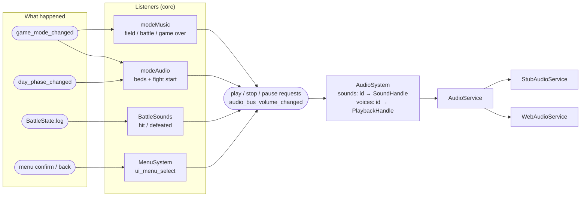
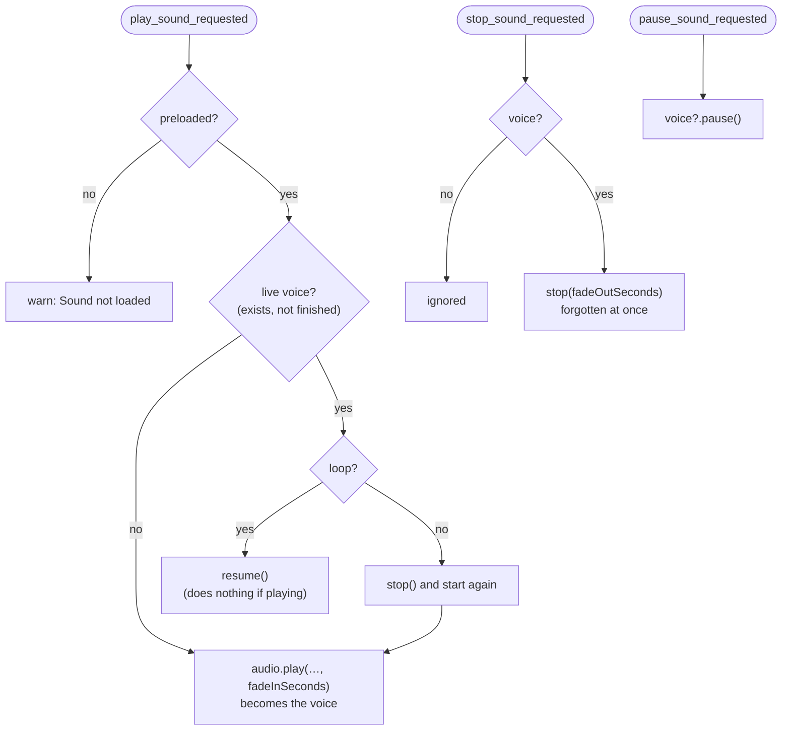
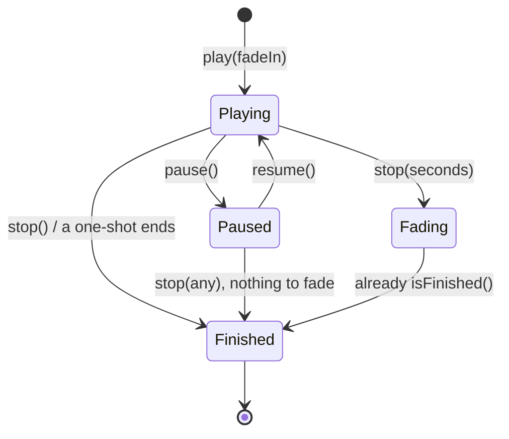
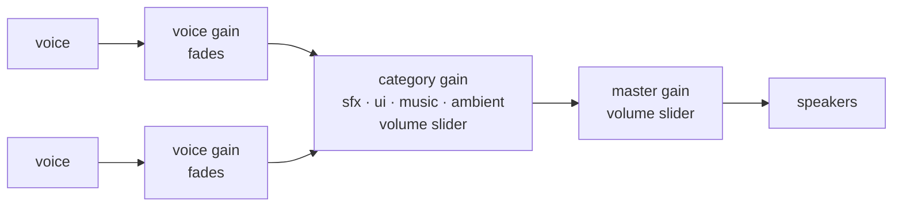
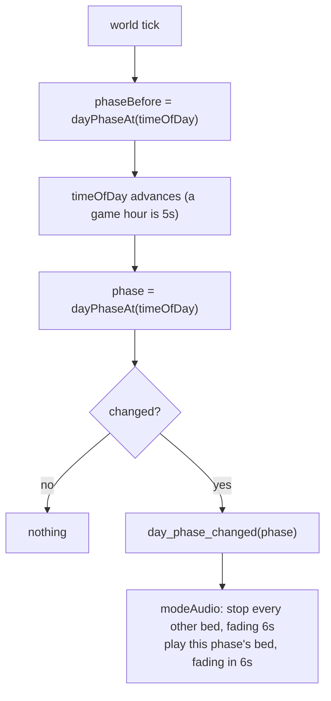
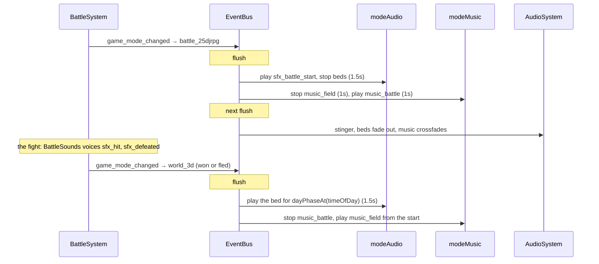
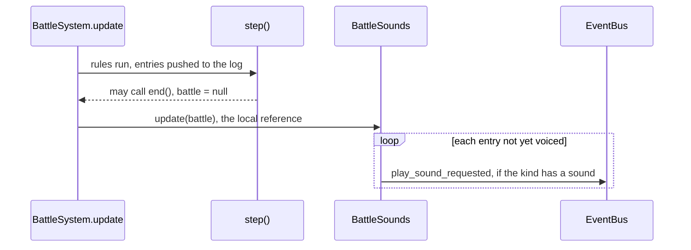
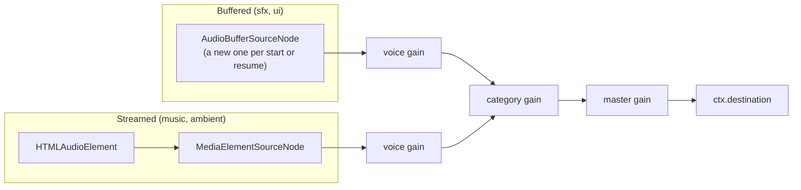
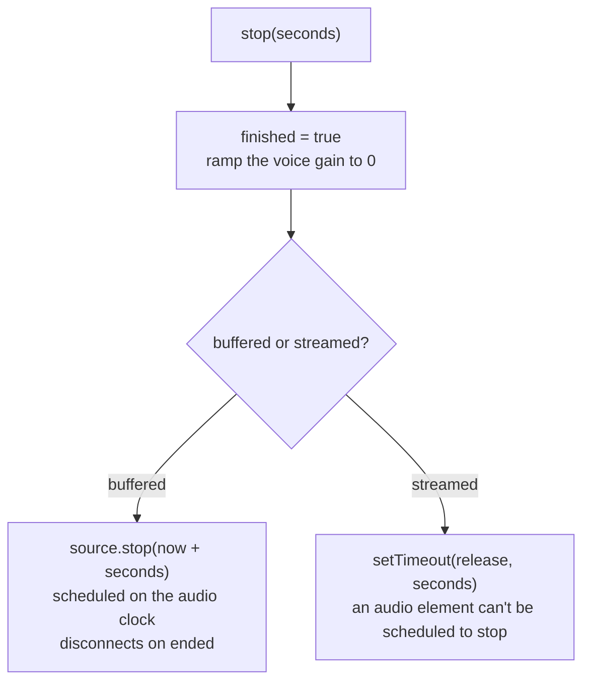

# Audio System

## Table of Contents

- [Where it lives](#where-it-lives)
- [The big picture](#the-big-picture)
- [Sounds and files](#sounds-and-files)
    - [Sound Compression](#sound-compression)
- [The service interface](#the-service-interface)
    - [Portability and separation of concerns](#portability-and-separation-of-concerns)
- [AudioSystem: one voice per sound](#audiosystem-one-voice-per-sound)
- [Mix buses and volume](#mix-buses-and-volume)
- [Fades](#fades)
- [Mode-driven audio](#mode-driven-audio)
    - [Ambience and the day phase](#ambience-and-the-day-phase)
    - [Music](#music)
    - [A fight, start to finish](#a-fight-start-to-finish)
- [Battle sounds](#battle-sounds)
- [Buffered vs. streamed sounds](#buffered-vs-streamed-sounds)
- [The web backend](#the-web-backend)
- [The stub backend and testing](#the-stub-backend-and-testing)
- [Rules it follows](#rules-it-follows)
- [Not built yet](#not-built-yet)
- [Navigation](#navigation)

## Where it lives

| File | Job |
| --- | --- |
| [audio.ts](../src/services/audio.ts) | The interface: `AudioService`, `SoundHandle`, `PlaybackHandle`, `AudioCategory` |
| [audioSystem.ts](../src/core/audio/audioSystem.ts) | Owns the loaded sounds and the voices. The only part of core that calls `AudioService` |
| [modeAudio.ts](../src/core/audio/modeAudio.ts) | The ambient bed for the time of day, and the fight's start sound |
| [modeMusic.ts](../src/core/audio/modeMusic.ts) | The music: one current track per mode |
| [battleSounds.ts](../src/core/battle/battleSounds.ts) | A fight's sound effects, voiced from its log |
| [environment.ts](../src/core/lighting/environment.ts) | `DayPhase` and `dayPhaseAt`, which the beds follow |
| [webAudioService.ts](../src/platforms/web/audio/webAudioService.ts) | The web backend: Web Audio graph, buffered and streamed voices, fades |
| [stubAudioService.ts](../src/platforms/stub/stubAudioService.ts) | The stub backend: records calls for specs |
| [game.ts](../src/game.ts) | Preloads every sound, and subscribes modeAudio and modeMusic |

**Core asks, the backend plays.** Nothing in core touches audio hardware. Listeners publish requests by sound ID, `AudioSystem` turns them into `AudioService` calls, and the backend decides how to play them.

## The big picture



Requests go through the event bus, which is flushed once per frame ([events.md](events.md#how-it-runs-today)). A request published while handling another event waits for the next frame, so audio follows a mode change one frame later.

## Sounds and files

Audio needs to be playable, pauseable, streamable, and stopable. Original sound fx will be created as lossless .wav, then exported and converted into .ogg directly into `public/assets/audio/`. The file name is the sound ID: snake_case, led by its purpose (`ui_menu_select.ogg`, `ambient_night.ogg`).

**Every current sound is a placeholder and subject to change:**

| Sound ID | Category | Played by |
|---|---|---|
| `ambient_day`, `ambient_night` | ambient | [modeAudio](#ambience-and-the-day-phase), looping, by time of day |
| `music_field`, `music_battle` | music | [modeMusic](#music), looping |
| `music_game_over` | music | modeMusic, once |
| `sfx_battle_start` | sfx | modeAudio, as a fight starts. A stand-in until the battle intro owns the transition |
| `sfx_hit`, `sfx_defeated` | sfx | [BattleSounds](#battle-sounds), from the fight's log |
| `ui_menu_select` | ui | `MenuSystem`, on confirm and back |

Sound IDs are the stable contract, so replacing a file needs no code change. `createGame` preloads every one at boot. A missing file is logged, not fatal: the game runs without it, and each play of it warns `Sound not loaded`. A new sound needs its preload in [game.ts](../src/game.ts), or it fails the same way.

Non-original audio is open source, royalty free, and free for commercial use. Sources are linked in the credits section of **[RESOURCES](RESOURCES.md)**.

### Sound Compression

For simplicity's sake, there's a set of bash scripts in `scripts/audio-aliases.sh` that will compress and cut dead-air from sound files.

To run, source the file `source scripts/audio-aliases.sh`.

Alternatively, you can run the script via bash.

**To compress and trim**, run only the commands without sourcing:

```bash
bash scripts/audio-aliases.sh --trim
```

Sourced:

```bash
mp32ogg-trim menu-select.mp3
# or
wav2ogg-trim footstep.wav
# or multiple
wav2ogg-trim jump.wav land.wav hit.wav
# or all audio files in current dir
audio2ogg-trim
```

**To compress, not trim**, run only the commands without sourcing:

```bash
bash scripts/audio-aliases.sh
```

With sourcing:

```bash
mp32ogg night-time.mp3
# or
wav2ogg overworld_theme.wav
# or multiple
wav2ogg jump.wav land.wav hit.wav
# or all
audio2ogg
```

## The service interface

```typescript
export type AudioCategory = 'master' | 'sfx' | 'music' | 'ambient' | 'ui';

export interface SoundHandle {
    // Opaque identifier, FFI-friendly and serializable
    readonly id: string;
}

export interface PlaybackHandle {
    pause(): void;
    resume(): void;
    // fadeOutSeconds ramps the voice down, then stops it. 0 or left out cuts at once.
    // Finished from the moment it's called, so core never waits on the fade.
    stop(fadeOutSeconds?: number): void;
    // True once the sound ends on its own or is stopped. A paused voice is not finished.
    isFinished(): boolean;
}

export interface AudioService {
    // Category lets the backend decide buffered vs streamed, core never knows which
    loadSound(soundId: string, category?: AudioCategory): Promise<SoundHandle>;
    // fadeInSeconds ramps the voice up from silence. 0 or left out starts at full volume.
    play(sound: SoundHandle, category?: AudioCategory, loop?: boolean, fadeInSeconds?: number): PlaybackHandle;
    setVolume(category: AudioCategory, volume: number): void;
    getVolume(category: AudioCategory): number;
}
```

### Portability and separation of concerns

Asset loading in Smackhem originally risked becoming a monolithic "God Asset Loader" combining chunks, textures, and maps. For audio, **Portability First** demands strict separation:

1. **Different Hardware Targets**: On native platforms and consoles, audio buffers route to sound chip memory or dedicated audio mixing threads (e.g., miniaudio, SDL_mixer, OpenAL). Textures route to GPU VRAM via graphics APIs, and chunks stream from disk into spatial world grids. Tying them together creates an artificial dependency tangle.
2. **AudioService Owns Audio Loading**: Just as [`Renderer`](rendering.md) owns mesh generation and texture loading (`loadTexture`), the `AudioService` owns sound loading, playback, and category mixing. There is no need for a separate loader interface.
3. **Opaque Handles (Constraints P-1, P-2)**: Core logic only holds an opaque `SoundHandle` (`{ readonly id: string }`). Core never knows about `AudioBuffer`, `AudioContext`, or hardware sound cards.
4. **Logical IDs (Rule A-1)**: Sounds are always requested by logical ID (`loadSound('ui_menu_select')`), never raw file paths or URLs. Path mapping (`/assets/audio/ui_menu_select.ogg`) is strictly a backend concern.

## AudioSystem: one voice per sound

We dropped the standalone `SoundRegistry`. Every backend already keeps a `soundId -> decoded buffer` cache: the web keeps `AudioBuffer`s, and a native backend (miniaudio, OpenAL) keeps its own sound objects. A registry in core would be a second copy of that map that has to stay in sync. The one thing it bought us was a synchronous lookup from an event's `soundId`, since `loadSound` is async. That lookup now lives in `AudioSystem`, which owns its handles and the audio event subscriptions. It ports to C++ as one system owning a `std::unordered_map<std::string, SoundHandle>`.

Sounds are preloaded up front, so playing one is a map lookup at flush time. Never load inside a handler (Pitfall 2, [events.md](events.md#pitfalls-to-avoid)).

**One voice per sound.** Like Godot's default `max_polyphony` of 1, or Unity's `AudioSource.Play()`, each sound has at most one live voice:

| Request | Voice state | Result |
|---|---|---|
| `play_sound_requested` with `loop: true` | playing | Ignored, so asking for ambience again is harmless. Its `fadeInSeconds` is ignored too |
| `play_sound_requested` with `loop: true` | paused | Resumed as it was, so "start or resume" is one request. No fade-in |
| `play_sound_requested` without loop | playing | Restarted, so rapid one-shots re-trigger cleanly |
| any play | none, stopped or finished | A new voice starts, fading in if `fadeInSeconds` is set |
| `pause_sound_requested` | any | Paused, can be resumed or stopped later |
| `stop_sound_requested` | any | Stopped and forgotten |
| `stop_sound_requested` with `fadeOutSeconds` | playing | Forgotten at once, and heard fading out. A play request during the fade starts a new voice, so the two overlap briefly |
| `stop_sound_requested` | none | Ignored, so stopping a sound that isn't playing is harmless |



This absorbs duplicate requests from several fixed ticks landing in one flush, and there are no voice lists to prune. A finished voice sits in the map until the sound plays again, so the map is bounded by the number of audio files shipped (M-2). If a sound ever needs real overlap, like several party members' footsteps, give it a voice limit and stop the oldest voice at the limit.

**A stopped voice is finished at once**, even while you can still hear it fading:



If the voice stayed live until its fade ended, a loop requested during the fade would hit the "playing" row, be resumed (which does nothing), and then fade to silence. The world would go quiet until something asked for its bed again.

Voices are checked with `isFinished()` from the tick, not through end-of-sound callbacks. On native backends those callbacks fire on the audio thread, and calling into core from there would need the MPSC queue or locks. Checking from the tick keeps audio single-threaded, and miniaudio supports it directly (`ma_sound_at_end`). It is `isFinished()` rather than `isPlaying()` so a paused voice is kept and can still be stopped.

## Mix buses and volume



What you hear is voice × category × master. Each gain has one job:

- **Voice gain:** fades, and nothing else
- **Category gain:** the player's slider for that category
- **Master gain:** the master slider

`audio_bus_volume_changed` is published by the Settings menu each time a volume steps, and by `createGame` once per bus at boot, to apply the saved volumes. `AudioSystem` passes it to `setVolume`.

## Fades

Fades are presentation. They run on the backend's audio clock, never the engine clock, and nothing in the simulation reads them, so they aren't a T-1 break. Core asks for one in a single request, `fadeInSeconds` on a play or `fadeOutSeconds` on a stop, and never steps a volume per tick.

- **Per voice, not per bus.** A crossfade needs one bed going down while another comes up, at the same moment, which one shared bus gain can't do. The bus gain also belongs to the player's slider, and a fade-in ramping it "to 1" would override their setting.
- **A fade-out starts from where the gain is now.** It cancels anything still scheduled and pins the current value first. A ramp starts from the last scheduled event, not the current value, so without the pin a fade-out that interrupts a fade-in would start from the fade-in's target (a swell, then the fade) or, with only the cancel, from its starting 0 (a cut).
- **A paused voice is cut, not faded**, since nothing is playing to fade. A resumed loop ignores `fadeInSeconds` and carries on as it was.

```text
gain
 1 ┤              ╭──╮               without cancel + pin: climbs to 1 first,
   │            ╭─╯   ╲                then falls over what's left of the fade
   │          ╭─╯ ●────╲───╮         with cancel + pin: falls from where it is (●)
 0 ┼────────●─╯         ╲   ╲───       over the whole fade
            fade-in    stop(6s)
```

There's no `fadeTo(volume, seconds)` yet. Ducking music under speech is the first thing that would need it.

## Mode-driven audio

Core systems only publish intent (Rule I-1). Two listeners turn `game_mode_changed` into requests, one per layer: [modeAudio](../src/core/audio/modeAudio.ts) for the ambient bed and [modeMusic](../src/core/audio/modeMusic.ts) for the music.

| Mode | Ambient bed (modeAudio) | Music (modeMusic) |
|---|---|---|
| `main_menu` | fades out | silence |
| `world_3d` | the bed for the time of day, fading in, or resumed if paused | field |
| `instance_3d` | fades out | field, carries on |
| `scene_2d` | pauses, resumed on return | field, carries on |
| `battle_25djrpg` | `sfx_battle_start`, and the bed fades out | battle |
| `game_over` | fades out | game over, plays once |

The pause menu isn't a mode change, so ambience and music keep playing while paused. The game boots into the start-up menu in silence, and the ambience and music start when New Game changes the mode to `world_3d`. That keypress also unlocks browser audio.

### Ambience and the day phase

`dayPhaseAt(timeOfDay)` is pure: day from 06:00 to 19:00, matching the sky's dawn and dusk keys, and night for the rest. `GameLoop` publishes `day_phase_changed` on the tick the phase changes. Only the world tick moves time, below the early returns for fights, speech, the 2D scene and the instance, so the phase can only change in `world_3d`.



- **Each phase has a bed** (`AMBIENT_BEDS`). On a phase change they crossfade over `DAY_PHASE_CROSSFADE_SECONDS` (6s, a little over one game hour). Mode changes fade over `AMBIENCE_FADE_SECONDS` (1.5s).
- **Entering the world reads the state, not the last event.** The bed is `dayPhaseAt(gameState.timeOfDay)`. Time can change without an event: quitting to the main menu resets it to midnight, and loading a save will set it too. Following events would play the wrong bed until the next phase change.
- **Stopping is "every bed but this one".** Nothing remembers which bed is playing, and a stop for a bed with no voice is ignored. A new phase (dawn) is an entry in `DayPhase` and `AMBIENT_BEDS`, plus its preload in game.ts. Nothing else in modeAudio changes.
- **The phase handler doesn't check the mode.** It relies on time standing still outside the world. If time ever moves during fights, it must check for `world_3d` first, or the next bed fades in under the battle music.
- **The Debug time-of-day override doesn't switch the bed.** It only changes what's drawn ([rendering.md](rendering.md#daynight-lighting-cycle)), and the bed follows simulation time.

### Music

One current track at a time, from the `MODE_MUSIC` table. When the mode's track is a different `MusicTrack` from the current one, the old track fades out and the new one fades in, both over `MUSIC_FADE_SECONDS` (1s).

- **The same track carries on.** The world, the instance and the 2D scene all point at the one `FIELD_MUSIC` object, so moving between them publishes nothing. Separate copies with the same sound ID would restart the music on every trip into the instance. Tracks are compared as objects, not by sound ID, so two modes can share a sound but play it differently (a `loop: false` version).
- **A stopped track is forgotten**, so coming back to it starts it over: the field music after a fight.
- **The current track isn't saved.** It's rebuilt from the mode on the first mode change, so a load must publish `game_mode_changed`, as quitting to the main menu does.
- The title screen is silent, and the game over music plays once.

### A fight, start to finish



A loss goes to `game_over` instead: the beds fade out and the game over music plays. A fight started from the instance returns to it, where there's no bed, and the field music.

## Battle sounds

The rules never ask for a sound. `BattleSounds` reads the fight's log the way `BattleScreen` words it ([battle.md](battle.md#the-battle-screen)): `LOG_SOUNDS` maps each entry kind to a sound or `null`, and each entry is voiced once.

| Log entry | Sound |
|---|---|
| `battle_started` | none, the mode change plays the start sound |
| `attacked` | `sfx_hit` |
| `defeated` | `sfx_defeated` |
| `battle_ended` | none, the music says how it ended |



- **Voiced after the step**, so whatever a tick logs sounds on that tick, even the tick that ends the fight.
- **A count, reset per fight.** `voiced` counts the entries already voiced, and `start()` resets it with `begin()`. Forgetting the reset silences the next fight's first entries, which the "second fight" scenario spec catches. `BattleScreen` notices a new fight by comparing `BattleState` objects instead, which fails safe if its reset is forgotten, but would mean `BattleSounds` holding a reference to the fight.
- **One request per action**, never per tick (M-1). A finishing blow logs `attacked` then `defeated`, so both sound together.

## Buffered vs. streamed sounds

- **Short sounds (sfx, ui)** are loaded and decoded into memory up front, for instant, low-latency playback.
- **Long sounds (music, ambient)** stream. Decompressing several multi-minute tracks into RAM causes buffer volatility (Pitfall 3). The backend streams them by `soundId` into their mix bus, without core knowing the asset's size or how it streams.
- **The backend decides**, by the category passed to `loadSound`. On the web, `music` and `ambient` stream through an `HTMLAudioElement`, and everything else is decoded into an `AudioBuffer`. Pass `loop: true` to `play` for loops.

## The web backend

[webAudioService.ts](../src/platforms/web/audio/webAudioService.ts) keeps the Web Audio API (`AudioContext`, `AudioBuffer`, gain nodes) inside the platform layer, completely hidden from `core/`.



- **Buffered voices** (`WebPlaybackHandle`) renew their source node on every resume, since `AudioBufferSourceNode`s are single-use. Pausing remembers the offset.
- **Streamed voices** (`WebStreamPlaybackHandle`) route an audio element through a `MediaElementSourceNode`. Finishing releases the network stream.
- **Autoplay.** Browsers start the `AudioContext` suspended, so `webBootstrap` calls the web-only `resumeContext()` on the first pointer or key press. A stream played before that gesture gets `NotAllowedError` from `play()`. The service queues those streams and retries them synchronously inside `resumeContext()`, because `play()` only counts as user-initiated during the gesture. A suspended context's clock stands still, so a queued stream still fades in once it plays.
- **Loading** is cached by sound ID, in flight included, so concurrent requests share one fetch and decode. A failed load is evicted so it can be retried. A sound's category is fixed by its first load.

A fade ramps the voice's own `GainNode`, and the end of a fade-out stops the voice one of two ways:



The stream's timer runs on the browser's clock, while the ramp runs on the audio clock. They can drift apart: if the `AudioContext` is suspended mid-fade, the stream is released at its frozen volume, and a background tab's throttled timer leaves a silent element running a little longer. Neither can be heard. The timer is platform code that only affects presentation, so it isn't a T-1 break either. Pausing a stream doesn't pause its fade-in, which keeps running on the audio clock.

## The stub backend and testing

To uphold the deletion test (Rule P-1), [StubAudioService](../src/platforms/stub/stubAudioService.ts) implements `AudioService` without any browser audio, so specs run headlessly in Node. It records each play call (with its `fadeInSeconds`, 0 for none) and each voice's state (with its `fadeOutSeconds`), so specs assert on audio without any timing.

- **Contract specs** run the same tests against the stub and the web service, so passing on the stub means the same thing as passing on the real backend. A stopped-with-a-fade voice being finished at once is part of the contract.
- **The web backend's own specs** run against [fakeWebAudio.ts](../src/testing/fakeWebAudio.ts). Its gain parameters record their scheduled sets and ramps instead of running them, and its time only moves when a spec sets it.
- **Scenario specs** drive the game on the stub platform: modeAudio, modeMusic, the day phase, and battle sounds. After a mode change, tick twice before asserting on audio (the change, then the requests).

## Rules it follows

- **Core never touches audio** (P-1). `AudioSystem` is the only part of core holding an `AudioService`, and it only ever sees opaque handles.
- **Sounds by ID** (A-1). Paths are the backend's.
- **Intent, not hardware** (I-1). Listeners publish requests. Nothing in the simulation waits on a sound.
- **No allocation per tick** (M-1). Requests are made per action or per mode change, never per tick. The voice map is bounded by the files shipped (M-2).
- **The engine clock stays the simulation's** (T-1). Fades and the stream timer run on the backend's clocks, and the simulation never reads them.

## Not built yet

Parked, waiting for the thing that makes them real:

- **More voices per sound:** voice keys or polyphony, for footsteps and overlapping hits.
- **Positional sound:** emitters in chunk data (a waterfall you walk towards), and carried sounds (a torch you hold).
- **Transitions:** the battle intro (the party popping out) owning the fight's start sound, a victory fanfare once there's a victory phase, and a record-scratch cut as a second kind of music change.
- **More beds and music:** dawn and dusk beds, title music.
- **Small sounds:** footsteps, an ATB ready ping.
- **`fadeTo`**, for ducking music under speech.

## Navigation

- **[Index](INDEX.md)** - Project overview and documentation index
- **[Portability Rules](portability-rules.md)** - All portability enforcement rules and constraints
- **[Architecture](architecture.md)** - High-level architecture, design principles, and platform strategy
- **[Rendering](rendering.md)** - Rendering system, lighting, day/night cycle, and display size
- **[Events and State](events.md)** - The event bus, global state, and the event reference
- **[Camera](camera.md)** - Camera system and mathematical formulas
- **[Systems](systems.md)** - World, party, input, collision, geometry, and menu systems
- **[Battle](battle.md)** - Fights: starting one, turns and ATB, commands, the field and battle camera
- **[Controls](controls.md)** - Keyboard, mouse and controller bindings
- **[Data Formats](data-formats.md)** - Chunk, settings, and save data formats
- **[Project Structure](project-structure.md)** - Code organization and project structure
- **[Porting Strategy](porting-strategy.md)** - Porting approach, learning path, and publishing
