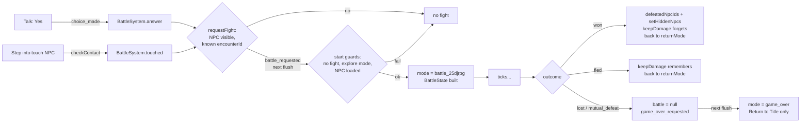
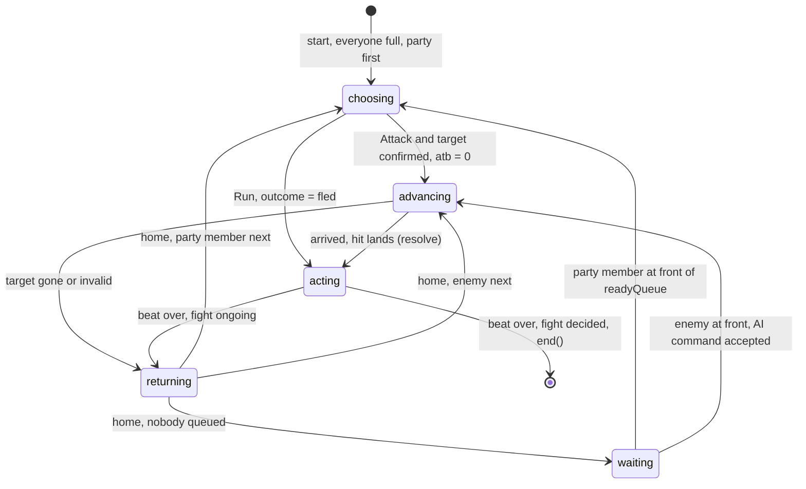

# Battle System

Fights happen where you stand, Chrono Trigger style. There's no separate battle screen: the party and the enemies pop out as billboards on the spot where the NPC stood, an ATB gauge decides who goes next, and attackers run to their target and back. Snippets are illustrative, not 1:1 with code (same as [architecture.md](architecture.md)).

Built in the battle spike (October 2026). This doc is how it works now.

## Table of Contents

- [Where it lives](#where-it-lives)
- [The life of a fight](#the-life-of-a-fight)
- [Starting a fight](#starting-a-fight)
- [Battle state](#battle-state)
- [A turn](#a-turn)
- [ATB: who goes next](#atb-who-goes-next)
- [Commands](#commands)
- [Ending a fight](#ending-a-fight)
- [The field and the battle camera](#the-field-and-the-battle-camera)
- [Drawing the fight](#drawing-the-fight)
- [The battle screen](#the-battle-screen)
- [Rules it follows](#rules-it-follows)
- [Debug](#debug)
- [Testing](#testing)
- [Not built yet](#not-built-yet)
- [Navigation](#navigation)

## Where it lives

| File | Job |
| --- | --- |
| [battle.ts](../src/core/battle/battle.ts) | The types: `Combatant`, `BattleCommand`, `BattlePhase`, `BattleState`, `BattleLogEntry` |
| [battleSystem.ts](../src/core/battle/battleSystem.ts) | Starts fights, runs turns, resolves commands, ends fights. The only thing that applies combat rules in a fight |
| [battleMenu.ts](../src/core/battle/battleMenu.ts) | The party's choice before it's confirmed: Command, then Target |
| [enemyAi.ts](../src/core/battle/enemyAi.ts) | An enemy's command. Today: attack the first standing party member |
| [battleField.ts](../src/core/battle/battleField.ts) | Pure layout math: where everyone stands, and the battle camera |
| [battleScreen.ts](../src/core/battle/battleScreen.ts) | Builds the `BattleView` the overlay draws, and words the log |
| [combat.ts](../src/core/combat.ts), [combatSheets.ts](../src/core/combatSheets.ts) | The rules (HP, attacks, outcome) and the data (sheets, encounters) |

**The menu reports, the battle system resolves.** `BattleMenu` and `enemyAi` both hand over a `BattleCommand`. `BattleSystem` checks it and resolves it exactly once. Neither the menu nor the view ever applies a rule.

## The life of a fight

From asking for a fight to leaving it. The sections below explain each step.



## Starting a fight

A hostile NPC has an `encounterId` in its chunk data, and a `startsFightOn` of `"talk"` (the default) or `"touch"` ([data-formats.md](data-formats.md)).

- **Talk:** the NPC's line ends in a Yes/No choice. Yes is selected to start. Up/down wrap. **Back always picks the last option**, so it reads as No. Choosing publishes `choice_made`, and Yes leads to the fight. No, or Back, closes it, and the NPC can be talked to again.
- **Touch:** walking into the NPC starts the fight with no question. Only **stepping into** contact counts, not standing against it. After running away you're still touching it, and nothing happens until you step away and back in. Talking to a touch NPC still asks.

However a fight starts, it ends in the same event:

```
choice_made (Yes) ──► BattleSystem.answer ──┐
walked into it    ──► BattleSystem.touched ─┴► requestFight ──► battle_requested ──► BattleSystem.start
```

`requestFight` looks the NPC up with `world.findNpc`, which only sees visible NPCs. A beaten NPC is hidden, so it can't be fought again.

`start` builds the fight one frame after it's asked for, and refuses (with a warning where it's a surprise) if:
- a fight is already running
- the mode isn't `world_3d` or `instance_3d`
- the NPC has unloaded in between

It switches the mode to `battle_25djrpg` and remembers where to go back to in `returnMode`. The name leaves room for other battle types later.

## Battle state

`GameState.discrete.battle` is the fight's whole truth while it runs, and `null` otherwise.

```ts
interface Combatant {
    id: CombatantId;          // 'party:0', 'enemy:1'
    side: 'party' | 'enemy';
    unit: PartyMember | Enemy;
    position: Vec3;           // where they are right now; moves while they run
    home: Vec3;               // their spot in the line; never moves
    atb: number;              // 0..1, full means queued to act
}

interface BattleState {
    encounterId; npcId;
    combatants: Combatant[];
    outcome: BattleOutcome;   // 'ongoing' until decided
    returnMode: GameMode;
    center: Vec3;             // where the NPC stood
    facing: number;           // the way you faced it
    layout: BattleLayout;     // a copy of the Debug layout, taken at the start
    phase: BattlePhase;
    readyQueue: CombatantId[];
    log: BattleLogEntry[];
}
```

- **`position` and `home` are two separate objects.** Running only moves `position`. If they were the same object, `home` would follow the runner and nobody would ever walk back.
- **Battle positions aren't world positions.** The world's `Npc` is never moved (W-1). While its fight is on, the renderer just doesn't draw it.
- **Combatants own their units for now.** Every party member starts each fight at full HP. When [party.ts](../src/core/party.ts) becomes real state, combatants will point at the party in `GameState` instead, so damage carries between fights. Battle creation stays in one place so that switch is small.

## A turn

`BattlePhase` is a union. Each phase carries only the fields that make sense for it:

| Phase | What's happening | Carries |
| --- | --- | --- |
| `waiting` | Nobody's gauge is full. Gauges fill | nothing |
| `choosing` | A party member's menu is open. Enemies skip this | `actingId` |
| `advancing` | Running to the target. The confirmed attack waits to land | `actingId`, `command` |
| `acting` | The hit has landed. Its beat plays | `actingId`, `beatRemaining` |
| `returning` | Running home | `actingId` |

How a turn moves between them. A party member's invalid command leaves them in `choosing`, and an enemy's throws ([Commands](#commands)):



**`update` runs once per battle tick**, in this order. Each `return` ends the frame:

1. Fill gauges, unless the menu is open in Wait mode, or the fight is decided.
2. If `acting`, count the beat down. Interact skips it. Still playing: stop.
3. If the fight is decided, end it.
4. If `waiting`, start the next turn when someone's in line.
5. Otherwise, do this phase's job.

Step 2 before step 3 is why you always see the finishing blow: the outcome is decided the moment the hit lands, but the fight only ends after its beat.

**The hit lands on arrival, not on confirm.** Confirming sets off the run, with no log entry and no HP change. The command lands on the `advancing` → `acting` step, exactly once, so one confirm is one resolution. **Interact skips whatever is playing:** the run there, the beat, or the run back.

**The target is checked again on every frame of the run.** If it's gone by the time the attacker arrives, they turn around and walk home, and the turn is spent. That can't happen yet with one party member. See [Not built yet](#not-built-yet) for the decided behavior.

| Constant | Value | Means |
| --- | --- | --- |
| `BATTLE_BEAT_SECONDS` | 1 | How long a landed hit's beat lasts |
| `BATTLE_RUN_SPEED` | 8 | Units per second across the field |
| `BATTLE_STRIKE_GAP` | 0.9 | How far short of the target an attacker stops, so they don't overlap |

## ATB: who goes next

- **The gauge** is a number from 0 to 1. Each tick it gains `ATB_FILL_PER_SECOND × dt` (1/3, so 3 seconds from empty to full), capped at 1. It's filled from the fixed step's `dt`, never a wall clock (T-1). A speed stat would later change the rate per combatant.
- **The line:** when a gauge hits 1, its owner is pushed onto the back of `readyQueue`. When a turn ends, the front of the line goes next. Anyone downed while waiting is skipped.
- **Not filling:** the downed, whoever is mid-turn (their gauge emptied when they set off), and anyone already full.
- **Everyone starts full**, queued in line order, party first. The first turn is instant and deterministic.
- **Wait and Active:** `Settings.battleMode`, a saved player setting with a "Battle Mode" row in Settings. Wait is the default.
  - **Wait** freezes every gauge while the command menu is open.
  - **Active** keeps them filling.
- **Pause stops everything** in both modes. GameLoop never ticks a paused battle, and pausing destroys nothing, including a half-chosen target.

**Turns are one actor at a time.** In Active mode, an enemy whose gauge fills while your menu is open waits in line until your turn ends, instead of attacking you mid-menu. See [Not built yet](#not-built-yet).

## Commands

```ts
type BattleCommand =
    | { kind: 'attack'; targetId: CombatantId }
    | { kind: 'run' };
```

- **Attack:** choose Attack, then a target. `navigate` moves the target cursor between standing enemies, and Back goes from Target back to Command.
- **Run:** no target, the whole party leaves. It's resolved where it's chosen and never enters `advancing`, which is why `advancing` carries attacks only (`Extract<BattleCommand, { kind: 'attack' }>`).
  - An encounter with `canRun: false` disables the row. The cursor skips it, and the web overlay fades it.
  - `BattleSystem` checks `canRun` again when Run arrives, because commands don't only come from the menu.
- **Enemies** never open a menu. `chooseEnemyCommand` returns a `BattleCommand` the same way the menu does, so per-enemy AI plugs in there. **It must return a command the fight accepts:** an attack on a standing party member, never Run (fleeing ends the fight as the party getting away). A refused enemy command throws. It can't just be skipped: the enemy is already off the queue with a full gauge, and nothing would queue it again.

## Ending a fight

A fight is decided when `outcome` leaves `'ongoing'`: `decideOutcome` after each landed hit, or `'fled'` on Run. Then `end()`:

| Outcome | What happens |
| --- | --- |
| `won` | The NPC's id goes into `defeatedNpcIds`, the World is told to hide it, kept HP is updated, and the mode goes back to `returnMode` |
| `fled` | Kept HP is updated and the mode goes back. Nobody is defeated, and the NPC stays to be talked to again |
| `lost` | The fight is dropped and `game_over_requested` is published. Nothing else: the NPC stays, nothing is kept |

**Game over** is its own `GameMode`, `'game_over'`, with its own root menu screen. Return to Title is the only way out. A loss publishes an event rather than switching modes itself, so `BattleSystem` never opens menus. For the one frame in between, the mode is still `battle_25djrpg` with `battle` already `null`, and `update` does nothing.

**Defeated means gone, and the World is the only gate.** Two places hold a defeat:
- **`GameState.discrete.defeatedNpcIds`** remembers it. It's plain, serializable data, the part a save will store.
- **The World** acts on it. `World.setHiddenNpcs(ids)` replaces its hidden set, then rebuilds its lists. Hidden NPCs aren't drawn, aren't solid, and `findNpc` can't see them, so they can't be fought. Hiding survives chunk reloads.

Nothing at fight time reads `defeatedNpcIds`. **Every time it's replaced wholesale, `setHiddenNpcs` must be called with it**, or the World keeps a stale set:
- after a win
- on quitting to the main menu, with the fresh empty list
- **when saves exist: on loading a save.** Forgetting it brings beaten NPCs back, visible and fightable.

Hiding depends on every NPC placement having a unique id (`npc_<who>_<n>`, [data-formats.md](data-formats.md)). `World` warns when a loaded chunk brings an id another loaded chunk already uses.

**Enemies that keep their damage** (FF6's Deathgaze): an enemy sheet with `keepsDamage: true` remembers its HP in `GameState.discrete.keptEnemyHp` when you run away, and comes back that hurt next time. A win forgets it. Quitting to the title throws it away. It's keyed by **sheet id**, so every encounter using the sheet is the same creature, wherever you meet it. Two distinct bosses need two sheets ([data-formats.md](data-formats.md)).

## The field and the battle camera

**The field** is laid out once, when the fight starts, by `placeCombatants` in [battleField.ts](../src/core/battle/battleField.ts):

```
          enemy   enemy        ← enemyDepth past the center
                 ✕             ← center: where the NPC stood
           party               ← partyDepth back towards you
     ↑ facing: the way you looked at the NPC
```

- `center` and `facing` are recorded once and never change, so the camera frames the fight steadily while people move inside it.
- Each side stands in a line across the facing, `spacing` apart and centered. With one fighter on a side, spacing does nothing.
- **`BattleLayout`** holds the three numbers. `DEFAULT_BATTLE_LAYOUT` is `{ partyDepth: 2, enemyDepth: 1.5, spacing: 1.5 }`. The Debug screen tunes them, and `start` copies them into `BattleState.layout`, so **a change applies from the next fight**, to the lines and the camera alike.

**The battle camera** is built by `battleCameraInto`, render-only:
1. Aim at the middle of the field, halfway between the two lines, 0.5 off the floor.
2. Look along `facing`, tipped down by the pitch (15° by default).
3. Back up `distance` (7 by default) from that point. At 15°, that's about 6.8 back and 1.8 up.

`GameLoop.getRenderCamera` swaps it in during a fight. It never writes the exploration camera, so there's nothing to restore when the fight ends.

**Nothing checks the field against the world yet.** The camera can end up inside or behind a wall, and a home can land inside a block. See [Not built yet](#not-built-yet).

## Drawing the fight

All of this is in [renderSystem.ts](../src/core/lighting/renderSystem.ts) (R-1).

- **Combatants** are billboards standing on their `position`, sprite from their sheet's `spriteId` (A-1). The defeated leave the field. The NPC whose fight is on, and the instance circle, aren't drawn during it.
- **Billboards** turn to face the camera. Upright by default, like a cardboard standee. With **Tilt Billboards** on, they also lean back to face the camera fully, at full height but leaning away from their feet. At the default 15° the difference is small.
- **Blob shadows**, off by default: a dark, flattened sphere under each combatant. A flat card's real shadow under a low sun is a thin sliver, and the blob grounds it. It's drawn as an ordinary lit mesh, not a see-through shadow, so it reads as a black puck. It's a Debug toggle until the renderer can blend it properly.

## The battle screen

The HUD is data, like the menus: `BattleScreen.build` fills one reused `BattleView` each frame from the fight and the menu, and the platform's `BattleOverlay` draws it ([battleOverlay.ts](../src/services/battleOverlay.ts)). It's never written back. The overlay gets `null` once when the fight ends.

- **The log has two jobs.** `BattleLogEntry` is the record: typed facts in core, pushed once per action, in a fixed order (`battle_started` first; a finishing blow is `attacked`, `defeated`, `battle_ended`). `damage` is the HP actually lost. Wording happens in `BattleScreen`, once per entry when it arrives, so tests assert on entries, never on strings.
- **Enemy HP and gauges are `null` in the view.** What the player may know is a core rule, so no platform can leak it.
- **`CombatantView` carries flags, not looks:** acting, targeted, defeated. The overlay picks how they're drawn, and marks never rely on color alone.
- **The web overlay** ([webBattleOverlay.ts](../src/platforms/web/overlays/webBattleOverlay.ts)) is a first pass: the newest log line in a top banner, enemy names, the party panel with an eight-block ATB gauge, and the command rows. It isn't the final design. The [party panel prototype](prototypes/party-panel.html) explores where it's heading.

## Rules it follows

- **Battle start is a second allocation boundary** (M-1). Combatants, the layout copy and the log are created when the fight starts and dropped when it ends. The per-tick update allocates nothing. The log grows once per action, never per tick.
- **Nothing holds the fight after it ends.** `gameState.battle` goes back to `null` and the overlay is handed `null`.
- **World data stays pure** (W-1). Battle positions are battle state, and defeat is a hidden set, not an edit to chunk data.
- **No randomness yet.** Fixed turn order and flat damage need none. When it arrives, it must be a seeded RNG with the seed in state, so scenario tests and replays stay deterministic.

## Debug

Debug-only data (D-1), in [combatSheets.ts](../src/core/combatSheets.ts):

| Encounter | For |
| --- | --- |
| `debug_crowd` | Three evil circles, for spacing and the Scales look check |
| `debug_boss` | A 30 HP enemy that keeps its damage |
| `debug_cornered` | Run is offered but disabled |

Debug screen rows for fights, in [debugSettings.ts](../src/core/settings/debugSettings.ts):

| Row | Applies |
| --- | --- |
| Tilt Billboards | At once |
| Blob Shadows | At once |
| Battle Cam Pitch (5–75°, 5° steps), Battle Cam Distance (3–20, 0.5 steps) | At once |
| Battle Party Depth, Battle Enemy Depth (0.5–8), Battle Spacing (0.5–5), quarter-unit steps | From the next fight |

Without a Debug screen, rendering and the layout use `createDebugSettings()`'s defaults.

## Testing

Scenario specs on the stub platform cover every path: starting, turns, the run-up, ATB, running away, touch, defeat and reloads, game over, the view and the field. They're listed in [project-structure.md](project-structure.md).

**Fights are driven through [battleScenario.ts](../src/testing/battleScenario.ts):** `startFight`, `skip`, `landAttack`, `winFight`, `loseFight`, `waitForTurn`, `playRound`. They carry the shape of a turn, so the next change to how a turn plays out is made there, not in every spec.

## Not built yet

Decided, waiting for the thing that makes them real:

- **Retargeting:** when an attacker's target goes down before the hit lands, they switch to another standing enemy, as in FF6 and Chrono Trigger. A difficulty option can later make them swing at nothing instead. Build it when a second party member or damage over time arrives.
- **Real Active:** enemies act while your menu is open. It needs the chooser pulled out of `BattlePhase` into its own field, so the menu can stay open while someone else animates.
- **Saves:** loading must call `setHiddenNpcs`, with a test that a beaten NPC stays gone after loading.
- **Camera and field fit:** keep the battle camera out of geometry, keep homes off walls, a field-of-view slider and a free-look battle camera behind Debug, and fighting on the spot versus a separate arena.
- **The party in `GameState`:** combatants point at it, and HP carries between fights.

Open, for later:

- **Chase:** enemies that come after you. A moving NPC needs runtime position state on top of the chunk data, which bends W-1.
- **Initiative:** ambush and preemptive starts. Nothing can produce them until chase or NPC facing exists.
- **The idle pan:** a comedy beat while the game waits on you. The camera swings up to look straight down and the billboards go paper-thin. Input cancels it, and reduced motion skips it.
- **Lens shift** and a fixed HUD band, if a crowded fight or 2× text pushes characters under the HUD.
- **Over-head drawing in fights:** the target cursor and damage numbers, and "A/B/C" letters for duplicate enemies.
- **Statuses:** opposite pairs cancel, and poison and regen tick on their own clocks. Which goes first on a shared tick gets settled then.

## Navigation

- **[Index](INDEX.md)** - Project overview and documentation index
- **[Portability Rules](portability-rules.md)** - All portability enforcement rules and constraints
- **[Architecture](architecture.md)** - High-level architecture, design principles, and platform strategy
- **[Rendering](rendering.md)** - Rendering system, lighting, day/night cycle, and display size
- **[Events, State, and Audio Systems](events.md)** - Eventing, global state, audio, and settings events
- **[Camera](camera.md)** - Camera system and mathematical formulas
- **[Systems](systems.md)** - World, party, input, collision, geometry, and menu systems
- **[Controls](controls.md)** - Keyboard, mouse and controller bindings
- **[Data Formats](data-formats.md)** - Chunk, settings, and save data formats
- **[Project Structure](project-structure.md)** - Code organization and project structure
- **[Porting Strategy](porting-strategy.md)** - Porting approach, learning path, and publishing
