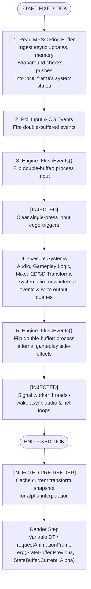

# Eventing, State, and Audio Systems

## Table of Contents

- [Introduction](#introduction)
- [Architectural Design](#architectural-design)
- [Proposed Implementation](#proposed-implementation)
    - [The Event Bus](#the-event-bus)
        - [Synchronous Events](#synchronous-events)
        - [Async and Multi-threaded Events](#async-and-multi-threaded-events)
        - [Double-buffered events](#double-buffered-events)
        - [MPSC Queue](#mpsc-queue)
    - [Global State management](#global-state-management)
    - [Audio Systems](#audio-systems)
        - [Portability & Separation of Concerns](#portability--separation-of-concerns)
        - [Audio Service Interface](#audio-service-interface)
        - [Audio System & Event Integration](#audio-system--event-integration)
        - [Menu Events](#menu-events)
        - [Settings Events](#settings-events)
        - [Mode-Driven Audio](#mode-driven-audio)
        - [Buffered vs. Streamed Sounds](#buffered-vs-streamed-sounds)
        - [Web Audio Platform Implementation](#web-audio-platform-implementation)
        - [Stub Platform & Testing (Rule P-1)](#stub-platform--testing-rule-p-1)
- [Pitfalls to Avoid](#pitfalls-to-avoid)
- [Navigation](#navigation)

## Introduction

There is information that needs to be delivered between naive systems, and that's what our event bus does. We trigger an event, and the necessary information is delivered to all relevant systems.

We abstract the event bus as if it runs in c++/OpenGL, in typescript. From there we create the functional equivalent to webGL.

## Architectural Design

Proposed flow



## Proposed Implementation

### The Event Bus

There will be two ways we do eventing. Both Multi-Producer Single-Consumer (MPSC) chains and a Double-Buffered bus.

Not to be confused with web-based events, which are all asynchronous. With node engines, we have access to asynchronous javascript. While this may be useful for short term events, not every engine works like node or chromium. 

While we may consider and utilize asynchronous javascript, the consideration for multi-threading in c++ is a non-negotiable eventuality. Both a double-buffered event bus, and an additional MPSC event chain for async/multi-threading, will be useful for porting and learning.

```typescript
type Event = {
   type: 'game_mode_changed';
   previousMode: GameMode; // 'world_3d' | 'instance_3d' | 'scene_2d'
   currentMode: GameMode;
}
```

Events will be explicitly typed. We'll subscribe listeners in the main logic, and will publish events in the game loop. Events will not affect state directly, subscribers will call event handlers per system as-required.

```typescript
interface EventBus {
    publish(event: Event): void;

    subscribe<K extends Event['type']>(
        type: K,
        handler: (event: ExtractEvent<K>) => void,
    ): () => void;
}
```

#### Synchronous Events

Synchronous double-buffered events allow for more predictability. Synchronous events will run per tick, which is currently set as `FIXED_DT` of a second (ticks per second). Simulation speed should not be directly tied into FPS. Synchronous events guarantee that every subscriber has received intended events which will allow for straight-forward debugging.

```javascript
const FIXED_DT = 1 / 60;
```

The typescript implementation will begin as synchronous until multi-threading becomes apparent. We would LIKE to avoid creating web-based service workers to imitate an actual c++ implementation. That would increase the breadth and scope of the project, and while service workers are incredibly useful for PWAs, we have no server. Sheerly imitating multi-threaded c++ isn't the goal, creating something port-forward is. Aside from the increased complexity, we're not facing the high-volume per millisecond calculations that would require several javascript threads.

The Event bus itself starts out synchronous and simple. Events should be both subscribable and unsubscribable.

```typescript
interface EventBus {
    publish(event: Event): void;

    subscribe<T extends Event>(
        type: T['type'],
        handler: (event: T) => void,
    ): () => void;
}
```

To avoid execution stalls, 

#### Async and Multi-threaded Events

Async and multi-threaded eventing is helpful with heavier lifts such as saving/loading, networking/snapshots, asset loading/streaming, and the audio engine.

Considerations for multi-threading will also be made when we decide to utilize async event triggers. Since we're running both 2D and 3D in C++, this will not be a small lift. Our multi-threaded Pub/Sub event bus is in consideration for becoming a mix of double-buffered and lock-free ring buffered (MPSC Queue).

#### Double-buffered Queue

Double-buffered event queues are primarily useful for single-threaded frame phases or simple batch job swaps. The initial complexity is low, and allows for dynamic vector resizing as well as array swapping. The is potential for 'high contention' across threads and will require a Mutex lock. It works well with highly variable payload sizes.

They rely on pointer swapping, are entirely deterministic, and can be sorted before execution. We can control nitty gritty render events and maximize cache performance manually.

Generic Double-buffered event queue with synchronous dispatch:

```typescript
export class TypeSafeEventBus implements EventBus {
    private listeners = new Map<string, Array<(event: any) => void>>();

    private incomingQueue: Event[] = [];

    private processingQueue: Event[] = [];

    publish(event: Event): void {
        this.incomingQueue.push(event);
    }

    flush(): void {
        if (this.incomingQueue.length === 0) return;

        this.processingQueue = this.incomingQueue;
        this.incomingQueue = [];

        for (let i = 0; i < this.processingQueue.length; i += 1) {
            const event = this.processingQueue[i];
            const handlers = this.listeners.get(event.type);
            if (handlers) {
                for (let j = 0; j < handlers.length; j += 1) {
                    handlers[j](event);
                }
            }
        }

        this.processingQueue = [];
    }

    subscribe<K extends Event['type']>(
        type: K,
        handler: (event: ExtractEvent<K>) => void,
    ): () => void {
        if (!this.listeners.has(type)) {
            this.listeners.set(type, []);
        }

        const handlers = this.listeners.get(type)!;
        handlers.push(handler);

        return () => {
            const currentHandlers = this.listeners.get(type);
            if (!currentHandlers) return;

            this.listeners.set(
                type,
                currentHandlers.filter((h) => h !== handler),
            );
        };
    }
}
```

#### MPSC Queue

The lock-free ring buffer, or MPSC queue, is useful for multi-threaded, high frequency, communication between workers and the main game loop. The initial complexity is high, it requires atomic operations and memory order fencing. We'd need to pre-allocate our memory. Benefit to the high complexity is that there would be no thread contention, since we'd be using lock-free pointers. Memory management can be painful, we might suffer from buffer overflow with a naive implementation, we'll need to watch that our consumers don't lag behind our producers.

These are non-blocking. Some systems will want to broadcast events without waiting on the main gameloop to recognize them. We don't need to worry about byte memory management, since we pre-allocate at startup. Our arrays and heaps won't need to dynamically resize or clear and pause the engine.

We can't easily sort pre-execution, we absolutely have to process them sequentially.

### Global State management

State is changing information which the engine utilizes to make determinations. Our pub / sub event service, system simulations, and global state complement one and another. State is authoritative simulation data. It is not responsible for broadcasting changes.

Systems may contain their own state. Accessing protected system data/state may change, but if state is not global, it is protected. Whether through events or public getters, protected state can be returned in different ways until patterns emerge. Trade-offs will be considered from there.

We have both state and a state buffer. True global state will live in the buffer. Cache will be computed from state, but never be stored or lerped independently.

The collision grid and world chunks are excluded from global state, purposefully. Since it's content and non-reliant on our simulated engine time, there's no benefit.

There's a current differentiation between discrete and interpolated state. Discrete state is directly copied. It's "true" state.

Interpolated state includes "in-between" values for other calculations/events that need to be free and unblocked. Per tick the interpolation may be running at 144 Hz vs a set 60Hz simulation speed. This allows for frame rates to be ran independently of the in-game engine.

```typescript
export interface State {
    interpolated: InterpolatedState;
    discrete: DiscreteState;
}
```

Initial implementation assumes game state will be updated per tick, rendering will handle Lerping separately. Constraints may be determined or elaborated as we progress.

```text
[ START FIXED TICK ]
   │
   ├── 1. Cache History ───> StateBuffer.Previous = StateBuffer.Current  (Zero-allocation pointer swap)
   │
   ├── 2. Simulate ────────> Run Systems ──> Mutates StateBuffer.Current
   │
[ END FIXED TICK ]
   │
   └── 3. Render Pass ─────> Lerp(StateBuffer.Previous, StateBuffer.Current, Alpha) ──> WebGL/OpenGl Draw
```

**Implemented so far: the camera.** Before each tick, `GameLoop` copies the camera's position, yaw and pitch. At render time it draws a blend of that copy and the current camera, with `alpha = accumulator / FIXED_DT` (how far the clock is into the next tick). That removes judder when the display refresh and the 60 Hz simulation don't line up: 144 Hz screens, or frames that run 0 or 2 ticks. The trade-off is that rendering trails the simulation by up to one tick (about 16 ms).

Not interpolated yet: the instance character and the 2D scene character. They move during short transitions, where it hasn't been noticeable. When loading a save teleports the camera, the blend should be skipped for that frame, or the first frame would draw a point halfway along the jump.

(Screen tearing, horizontal split lines, is a different problem. It comes from how the browser and the OS present frames, for example NVIDIA on X11, and the game can't fix it.)

### Audio Systems

Audio needs to be playable, pauseable, streamable, and stopable. For game engines requiring low latency and precision playback, the strategy is to fetch audio files as binary ArrayBuffers, decode them into raw PCM buffers (e.g. Web Audio `AudioBuffer`), and wrap them behind platform-agnostic handles.

Original sound fx will be created as lossless .wav, then exported and coverted into .ogg directly into smackhem/public/assets/audio/. The file name is the sound ID: snake_case, led by its purpose (`ui_menu_select.ogg`, `ambient_night.ogg`).

**Every current sound is a placeholder and subject to change:** `ambient_night`, `sfx_mode_change` and `ui_menu_select` (currently the same file as `sfx_mode_change`). Sound IDs are the stable contract, so replacing a file needs no code change. Non-original audio is open source, royalty free, and free for commercial use. Sources are linked in the credits section of **[RESOURCES](RESOURCES.md)**.

#### Sound Compression

For simplicity's sake, there's a set of bash scripts in `scripts/audio-aliases.sh` that will compress and cut dead-air from sound files.

To run, source the file `source scripts/audio-aliases.sh`.

Alternatively, you can run the script via bash.

##### To compress and trim:

Run only the commands without sourcing

```bash
bash scripts/audio-aliases.sh --trim
```

Sourced

```bash
mp32ogg-trim menu-select.mp3
# or
wav2ogg-trim footstep.wav
# or multiple
wav2ogg-trim jump.wav land.wav hit.wav
# or all audio files in current dir
audio2ogg-trim
```

##### To compress, not trim:

Run only the commands without sourcing

```bash
bash scripts/audio-aliases.sh
```

With sourcing

```bash
mp32ogg night-time.mp3
# or
wav2ogg overworld_theme.wav
# or multiple
wav2ogg jump.wav land.wav hit.wav
# or all
audio2ogg
```

#### Portability & Separation of Concerns

Asset loading in Smackhem originally risked becoming a monolithic "God Asset Loader" combining chunks, textures, and maps. For audio, **Portability First** demands strict separation:

1. **Different Hardware Targets**: On native platforms and consoles, audio buffers route to sound chip memory or dedicated audio mixing threads (e.g., miniaudio, SDL_mixer, OpenAL). Textures route to GPU VRAM via graphics APIs, and chunks stream from disk into spatial world grids. Tying them together creates an artificial dependency tangle.
2. **AudioService Owns Audio Loading**: Just as [`Renderer`](rendering.md) owns mesh generation and texture loading (`loadTexture`), the [`AudioService`](#audio-service-interface) owns sound loading, playback, and category mixing. There is no need for a separate loader interface.
3. **Opaque Handles (Constraints P-1, P-2)**: Core logic only holds an opaque `SoundHandle` (`{ readonly id: string }`). Core never knows about `AudioBuffer`, `AudioContext`, or hardware sound cards.
4. **Logical IDs (Rule A-1)**: Sounds are always requested by logical ID (`loadSound('ui_select')`), never raw file paths or URLs. Path mapping (`/assets/audio/ui_select.ogg`) is strictly a backend concern.

#### Audio Service Interface

```text
Individual PCM Playback Voice (e.g., SFX Effect)
               │
               ▼
         [sfxGainNode]       [uiGainNode]      [musicGainNode]
              │                    │                  │
              └───────────┬────────┴──────────────────┘
                          ▼
                   [masterGainNode]
                          │
                          ▼
                 [Hardware Speakers]
```

With consideration for multiple sound types and volume, we support audio categories and mix buses.

```typescript
export type AudioCategory = 'master' | 'sfx' | 'music' | 'ambient' | 'ui';

export interface SoundHandle {
    // Opaque identifier, FFI-friendly and serializable
    readonly id: string;
}

export interface PlaybackHandle {
    pause(): void;
    resume(): void;
    stop(): void;
    // True once the sound ends on its own or is stopped. A paused voice is not finished.
    isFinished(): boolean;
}

export interface AudioService {
    // Category lets the backend decide buffered vs streamed, core never knows which
    loadSound(soundId: string, category?: AudioCategory): Promise<SoundHandle>;
    play(sound: SoundHandle, category?: AudioCategory, loop?: boolean): PlaybackHandle;
    setVolume(category: AudioCategory, volume: number): void;
    getVolume(category: AudioCategory): number;
}
```

#### Audio System & Event Integration

We dropped the standalone `SoundRegistry`. It isn't needed on the web, and it isn't needed for C++.

Every backend already keeps a `soundId -> decoded buffer` cache: the web keeps `AudioBuffer`s, and a native backend (miniaudio, OpenAL) keeps its own sound objects. A registry in core would be a second copy of that map that has to stay in sync. The one thing it bought us was a synchronous lookup from an event's `soundId`, since `loadSound` is async. That lookup now lives in `AudioSystem` (`src/core/audio/audioSystem.ts`), which owns its handles and the audio event subscriptions. It's the same shape as other systems holding their `TextureHandle`s, and it ports to C++ as one system owning a `std::unordered_map<std::string, SoundHandle>`.

```typescript
export default class AudioSystem {
    private sounds = new Map<string, SoundHandle>();

    // One voice per sound
    private voices = new Map<string, PlaybackHandle>();

    constructor(audio: AudioService, eventBus: TypeSafeEventBus) {
        eventBus.subscribe('play_sound_requested', (event) => {
            const handle = this.sounds.get(event.soundId);
            if (!handle) return; // Never load inside a handler (Pitfall 2)

            const voice = this.voices.get(event.soundId);
            if (voice && !voice.isFinished()) {
                // Loops continue, or resume if paused. One-shots restart.
                if (event.loop) {
                    voice.resume();
                    return;
                }
                voice.stop();
            }

            this.voices.set(event.soundId, audio.play(handle, event.category, event.loop));
        });

        eventBus.subscribe('pause_sound_requested', (event) => {
            this.voices.get(event.soundId)?.pause();
        });

        eventBus.subscribe('stop_sound_requested', (event) => {
            const voice = this.voices.get(event.soundId);
            if (!voice) return;
            voice.stop();
            this.voices.delete(event.soundId);
        });

        eventBus.subscribe('audio_bus_volume_changed', (event) => {
            audio.setVolume(event.category, event.volume);
        });
    }

    public async preload(soundId: string, category: AudioCategory): Promise<void>;
}
```

Sounds are preloaded up front, so playing one is a map lookup at flush time.

**One voice per sound.** Like Godot's default `max_polyphony` of 1, or Unity's `AudioSource.Play()`, each sound has at most one live voice:

| Request | Voice state | Result |
|---|---|---|
| `play_sound_requested` with `loop: true` | playing | Ignored, so asking for ambience again is harmless |
| `play_sound_requested` with `loop: true` | paused | Resumed, so "start or resume" is one request |
| `play_sound_requested` without loop | playing | Restarted, so rapid one-shots re-trigger cleanly |
| any play | none, stopped or finished | A new voice starts |
| `pause_sound_requested` | any | Paused, can be resumed or stopped later |
| `stop_sound_requested` | any | Stopped and forgotten |

This absorbs duplicate requests from several fixed ticks landing in one flush, and there are no voice lists to prune. A finished voice sits in the map until the sound plays again, so the map is bounded by the number of audio files shipped (M-2). If a sound ever needs real overlap, like several party members' footsteps, give it a voice limit and stop the oldest voice at the limit.

**Volume.** `audio_bus_volume_changed` is published by the Settings menu each time a volume steps, and by `main.ts` once per bus at boot, to apply the saved volumes. `AudioSystem` passes it to `setVolume`.

Voices are checked with `isFinished()` from the tick, not through end-of-sound callbacks. On native backends those callbacks fire on the audio thread, and calling into core from there would need the MPSC queue or locks. Checking from the tick keeps audio single-threaded, and miniaudio supports it directly (`ma_sound_at_end`). It is `isFinished()` rather than `isPlaying()` so a paused voice is kept and can still be stopped.

#### Menu Events

`quit_to_main_menu_requested` has no payload. The pause menu publishes it when Quit is confirmed, and `GameLoop` handles it by resetting to a fresh boot: game state, camera and menu, followed by `game_mode_changed` to `main_menu`. Pausing and resuming publish nothing; they only set `DiscreteState.isPaused`.

#### Settings Events

`settings_changed` has no payload. Settings live in one shared `Settings` object (`src/core/settings/settings.ts`), which the menu changes in place, so subscribers read it directly. `main.ts` subscribes and saves the settings to storage. `bindDisplay` (`src/core/settings/displaySettings.ts`) subscribes and applies render scale, window size and fullscreen to the platform. When the platform reports a fullscreen change itself (a refusal, Escape, the page's button), it updates `settings.fullscreen` and publishes `settings_changed` so the menu redraws. Look sensitivity and invert need no event: `GameLoop` reads them every tick.

#### Mode-Driven Audio

Core systems only publish intent (Rule I-1). `src/core/audio/modeAudio.ts` turns `game_mode_changed` into audio requests: `sfx_mode_change` plays on every change, and `ambient_night`

- pauses when entering the 2D scene (`scene_2d`)
- stops when entering the instance (`instance_3d`)
- starts or resumes when returning to the world (`world_3d`)
- stops when quitting to the main menu (`main_menu`)

The pause menu isn't a mode change, so the ambience keeps playing while paused.

```typescript
eventBus.subscribe('game_mode_changed', (event) => {
    eventBus.publish({ type: 'play_sound_requested', soundId: MODE_CHANGE_SOUND, category: 'sfx' });

    switch (event.currentMode) {
        case 'scene_2d':
            eventBus.publish({ type: 'pause_sound_requested', soundId: AMBIENT_SOUND });
            break;
        case 'instance_3d':
            eventBus.publish({ type: 'stop_sound_requested', soundId: AMBIENT_SOUND });
            break;
        case 'world_3d':
            playAmbience(eventBus); // looping play_sound_requested
            break;
        default:
            break;
    }
});
```

Requests published from inside a handler go into the next flush, so audio follows a mode change one frame later. `main.ts` preloads the sounds (a missing file is logged, not fatal) and subscribes these rules. The game boots into the start-up menu in silence, and the ambience starts when New Game changes the mode to `world_3d`. That keypress also unlocks browser audio.

#### Buffered vs. Streamed Sounds

Audio needs vary significantly based on clip length and memory footprint:

- **Short Sounds (SFX / UI)**: Pre-loaded and decoded into memory via `audioService.loadSound()`. Stored as decompressed PCM buffers for instant, low-latency playback across polyphonic voices.
- **Long Sounds (Music / Ambience / Environmental loops)**: Streaming is not exclusive to music—long ambient loops (rain, wind, river) and heavy sound effects must also be streamed. Decompressing several multi-minute tracks into RAM causes severe buffer volatility (Pitfall 3). The audio backend handles streaming on-demand by `soundId` directly into the designated mix bus, without core needing to know the asset's size or streaming mechanism.
- **Who decides**: the backend, by the category passed to `loadSound`. On the web, `music` and `ambient` stream through an `HTMLAudioElement`, and everything else is decoded into an `AudioBuffer`. Pass `loop: true` to `play` for loops.

#### Web Audio Platform Implementation

The Web platform implementation packs the Web Audio API primitives (`AudioContext`, `AudioBuffer`, gain nodes) safely inside the backend layer, completely hidden from `core/`.

**WebSoundHandle**:
```typescript
export class WebSoundHandle implements SoundHandle {
    // Hidden from core: contains raw decompressed PCM AudioBuffer in memory
    public readonly buffer: AudioBuffer;
    public readonly id: string;

    constructor(id: string, buffer: AudioBuffer) {
        this.id = id;
        this.buffer = buffer;
    }
}
```

**WebPlaybackHandle & WebAudioService**:
The web platform requires renewing source nodes upon resumption since Web Audio `AudioBufferSourceNode`s are single-use. Browsers also start the `AudioContext` suspended, so `webBootstrap` calls the web-only `resumeContext()` on the first pointer or key press. Streams have the same problem: a stream played before that gesture (like the boot ambience) gets `NotAllowedError` from `play()`. The service queues those streams and retries them synchronously inside `resumeContext()`, because `play()` only counts as user-initiated during the gesture. `WebAudioService` also handles decoding audio buffers, managing mix buses, and streaming longer tracks via media elements routed into category gain nodes.

```typescript
export class WebPlaybackHandle implements PlaybackHandle {
    // ... tracks sourceNode, pauseOffset, buffer duration ...
    public resume(): void {
        if (this.isPlaying) return;
        if (this.pauseOffset < this.buffer.duration) {
            this.start(this.pauseOffset);
        }
    }
}

export class WebAudioService implements AudioService {
    // Keyed by sound ID only, a sound's category is fixed by its first load
    private cache: Map<string, Promise<SoundHandle>> = new Map();
    private audioContext?: AudioContext;
    private basePath: string;

    constructor(basePath: string, audioContext?: AudioContext) {
        this.basePath = basePath;
        this.audioContext = audioContext;
    }

    public loadSound(soundId: string, category: AudioCategory = 'sfx'): Promise<SoundHandle> {
        const cached = this.cache.get(soundId);
        if (cached) return cached;

        // Cache the in-flight load so concurrent requests share one fetch and decode
        const pending = this.fetchSound(soundId, category);
        this.cache.set(soundId, pending);
        pending.catch(() => this.cache.delete(soundId)); // failed loads can be retried
        return pending;
    }

    private async fetchSound(soundId: string, category: AudioCategory): Promise<SoundHandle> {
        const path = `${this.basePath}${soundId}.ogg`;
        if (STREAMED_CATEGORIES.has(category)) {
            // music/ambient: keep only the URL, stream on play
            return new WebStreamHandle(soundId, path);
        }

        const response = await fetch(path);
        const arrayBuffer = await response.arrayBuffer();
        const audioBuffer = await this.getAudioContext().decodeAudioData(arrayBuffer);
        return new WebSoundHandle(soundId, audioBuffer);
    }

    public play(sound: SoundHandle, category: AudioCategory = 'sfx', loop: boolean = false): PlaybackHandle {
        const ctx = this.getAudioContext();
        const output = this.getCategoryGain(category);

        if (sound instanceof WebStreamHandle) {
            return new WebStreamPlaybackHandle(ctx, sound.url, output, loop);
        }
        if (sound instanceof WebSoundHandle) {
            return new WebPlaybackHandle(ctx, sound.buffer, output, loop);
        }
        throw new Error(`Invalid asset passed to WebAudioService: ${sound.id}`);
    }
}
```

#### Stub Platform & Testing (Rule P-1)

To uphold the deletion test (Rule P-1), a `StubAudioService` is provided in `src/platforms/stub/`. It implements `AudioService` and returns mock `SoundHandle` and `PlaybackHandle` objects without instantiating any browser audio contexts, ensuring that unit and integration tests run headlessly in Node/Vitest without mock polyfills.

## Pitfalls to Avoid

1. Events indicate what happened, not what should happen. Keep payloads informational, do not pack direct mutations.
2. Immediate handlers create execution stalls. Subscribers handle tasks lazily or queue them.
3. Avoid buffer volatility. Decompressing files into memory scales footprints significantly. Large ambient tracks or background music loops must be routed via streaming targets instead of being cached.
4. Read the old value before you overwrite it. A `previousMode` read after `gameMode` is assigned equals `currentMode`, so the change looks like a no-op and the event is silently dropped.

## Navigation

- **[Index](INDEX.md)** - Project overview and documentation index
- **[Portability Rules](portability-rules.md)** - All portability enforcement rules and constraints
- **[Architecture](architecture.md)** - High-level architecture, design principles, and platform strategy
- **[Rendering](rendering.md)** - Rendering system, lighting, day/night cycle, and display size
- **[Camera](camera.md)** - Camera system and mathematical formulas
- **[Systems](systems.md)** - World, party, input, collision, geometry, and menu systems
- **[Controls](controls.md)** - Keyboard, mouse and controller bindings
- **[Data Formats](data-formats.md)** - Chunk, settings, and save data formats
- **[Project Structure](project-structure.md)** - Code organization and project structure
- **[Porting Strategy](porting-strategy.md)** - Porting approach, learning path, and publishing
