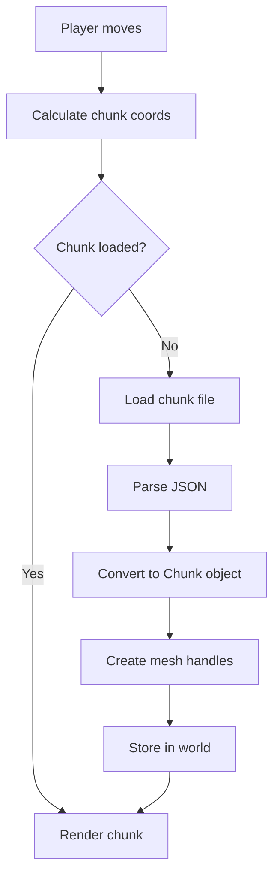

# Systems

## Table of Contents

- [Instance System](#instance-system)
  - [Instance System Architecture](#instance-system-architecture)
  - [Instance Transition](#instance-transition)
  - [Instance Character Management](#instance-character-management)
  - [Separation of Concerns](#separation-of-concerns)
- [World System](#world-system)
  - [World Structure](#world-structure)
  - [Chunk Definition](#chunk-definition)
  - [Chunk Streaming](#chunk-streaming)
- [Geometry Rules (Intentional Constraints)](#geometry-rules-intentional-constraints)
- [Geometric Mesh Generation](#geometric-mesh-generation)
  - [Cube Mesh](#cube-mesh)
  - [Pyramid Mesh](#pyramid-mesh)
  - [Sphere Mesh (UV Sphere)](#sphere-mesh-uv-sphere)
  - [Plane Mesh](#plane-mesh)
  - [Prism Mesh](#prism-mesh)
- [Input System (Console-Ready)](#input-system-console-ready)
  - [Input Intent](#input-intent)
  - [Bare Web Input Backend](#bare-web-input-backend)
  - [Console Input Backend (Future)](#console-input-backend-future)
- [Party System (Drakkhen-Style)](#party-system-drakkhen-style)
  - [Party Structure](#party-structure)
  - [Party/Enemy Behavior](#partyenemy-behavior)
- [Collision System](#collision-system)
- [Interaction System](#interaction-system)
- [Scene System](#scene-system)
- [Menu System](#menu-system)
- [Navigation](#navigation)

## World System

### World Structure

```typescript
World {
    activeChunks: Map<ChunkID, Chunk>
}
```

Each chunk is:

- Static geometry
- Collision bounds
- No logic

### Chunk Definition

```typescript
Chunk {
  id: ChunkID;
  bounds: AABB;
  collisionAABBs: AABB[]; // NPC boxes included, the same objects as Npc.collisionAABB
  meshes: StaticMesh[];
  hasContent: boolean;
  npcs: Npc[];
}

Npc {
  id: string;
  textureId: string; // asset ID
  position: Vec3;    // world space, base of the sprite
  size: number;
  collisionAABB: AABB;
  line: string;
}

StaticMesh {
  mesh: MeshHandle;
  transform: Mat4;
  color: Vec3;
}
```

### Chunk Streaming

- Player position determines active radius
- **Only on entering another chunk:** `createGame`'s frame compares the player's chunk coordinates as plain numbers (`World.getChunkIndex`), and calls the platform's chunk updater only when they change. The frames in between allocate nothing: no call, no Promise (M-1). Quitting to the main menu moves the camera back to the start, which counts as a change.
- Load:
  - Current chunk
  - Adjacent chunks (within `CHUNK_LOAD_RADIUS`)
- Unload far chunks (outside active radius)

**Loading Implementation:**

- Chunks are loaded **asynchronously** from JSON files via `fetch()`
- Multiple chunks load in **parallel** using `Promise.all` for performance
- Chunk loading is **non-blocking** in the game loop (fire-and-forget pattern)
- Loaded chunks are **cached in memory** to avoid re-fetching/re-parsing
- Pending chunk loads are tracked to avoid duplicate requests

**Error Handling:**

- Missing chunk files: System creates empty fallback chunk (floor plane only)
- Invalid JSON: Logs error and creates empty fallback chunk
- Network errors: Falls back to empty chunk creation

This works identically on:

- Web (async `fetch()` with Promise-based loading)
- Desktop (future: same async pattern)
- Console (future: same async pattern)

**Known limits (revisit when they matter):**

Nothing is freed when a chunk unloads, and that is deliberate for now. Two caches keep everything:
- **Renderer mesh cache:** keyed by shape and size (`cube_1`, `plane_10`, …). Chunks share these meshes.
- **`ChunkLoader`'s kept chunks** (core, one per game's chunk updater): every chunk ever loaded, empty stand-ins for missing or broken files included, so walking back is instant and a bad file is only fetched once.

So GPU memory grows with the number of *distinct shape sizes*, not with how much the player walks, and memory overall grows with the number of chunks visited. With the current hand-made map this is tiny.

**Don't** simply delete GL buffers in `World.removeChunk`. Meshes are shared between chunks, and the chunk cache still holds their handles, so the deleted buffers would be drawn again (missing geometry, or a crash).

| When | Do | Trade-off |
|---|---|---|
| Maps grow large, or long sessions visit many chunks | **Cap the chunk cache** (least recently used chunks dropped). Never delete meshes: the mesh cache is already bounded by the number of distinct sizes. | Revisiting an evicted chunk re-fetches and re-parses it, which can hitch at chunk boundaries. No risk of drawing deleted buffers. |
| The native port (tight video memory, consoles), or maps with many unique mesh sizes | **Reference-count meshes**: add `disposeMesh` to the `Renderer` interface and free a mesh only when no loaded *or* cached chunk still uses it. This also settles W-2 ("chunks own their meshes"): today the renderer owns them and chunks share them. | Getting the counts wrong means drawing deleted buffers, which is worse than the leak it fixes. Needs careful tests. |

A related race: chunk updates are async on the web. If the player crosses two chunk boundaries before the first update's loads finish, that update can unload chunks the second one needs, leaving a gap until the next crossing. It's rare at walking speed. Fix it with the cache work above, for example by letting only the newest update unload.

**Loading gate (consider when the player can outrun streaming):** today the player can walk into a chunk whose data hasn't arrived yet and briefly see an empty area until it does. Many games instead pause play and show a spinner when the player gets ahead of loading. When it becomes an issue:
- **When to trigger:** fast travel or vehicles, teleports, loading a save (which drops the player somewhere new), or slow storage and networks.
- **How it could fit:** each tick, core checks whether the player's chunk and its neighbours are in `world.activeChunks`. If not, it holds the simulation, the same way `isPaused` does, and shows a loading overlay until they arrive. Rendering keeps running so the spinner animates.
- **Trade-off:** a visible stop is honest and avoids walking into missing geometry, but it interrupts play. Prefer preventing it first, with a larger load radius in the direction of travel or prefetching before teleports, and keep the gate as the fallback.

### Chunk flow



## Geometry Rules (Intentional Constraints)

- No Curves or Smooth Surfaces: The game will strictly use geometric shapes such as cubes, pyramids, prisms, and planes. This constraint is intentional to simplify the design and rendering pipeline, making it easier to batch objects and optimize performance.
- No Textures: The game will only use solid colors or shaders for visual effects, making it more minimalist and geometric in appearance.
- 3D Spheres/Organic Shapes: While we've added spheres, they'll be used sparingly for specific objects (e.g., environmental details like orbs), and they won't dominate the design language.
- 2D simulated 'Spheres' and weird shapes will be a thing. Don't expect much from the lighting, but we'll do what we can because we must. If we can get a weird parabolic squiggle as a playable character, that looks gorgeous with the lighting, we've done our job.

Why:

- Easy to batch
- Easy to serialize
- Easy to port
- Easy to debug

## Geometric Mesh Generation

The renderer provides methods to generate geometric meshes procedurally. All meshes are created through the `Renderer` interface, ensuring platform-agnostic mesh creation.

### Cube Mesh

For a cube of size `s`, centered at origin:

```typescript
half = s / 2
vertices = [
    // 6 faces * 2 triangles * 3 vertices = 36 vertices
    // Each face: two triangles forming a square
    // Front face: (-h,-h,h), (h,-h,h), (h,h,h), (-h,-h,h), (h,h,h), (-h,h,h)
    // Back face: (-h,-h,-h), (-h,h,-h), (h,h,-h), (-h,-h,-h), (h,h,-h), (h,-h,-h)
    // Left, Right, Top, Bottom faces follow similar pattern
]
```

The cube is generated with proper vertex normals for lighting calculations. Normals are calculated automatically from vertex winding order.

### Pyramid Mesh

For a pyramid of base size `s` and height `h`:

```typescript
half = s / 2
apex = h
// Base: square (2 triangles)
//   (-h,0,-h), (h,0,-h), (h,0,h), (-h,0,-h), (h,0,h), (-h,0,h)
// 4 faces: triangles from base corners to apex
//   Front: (-h,0,h), (h,0,h), (0,apex,0)
//   Back: (h,0,-h), (-h,0,-h), (0,apex,0)
//   Left: (-h,0,-h), (-h,0,h), (0,apex,0)
//   Right: (h,0,h), (h,0,-h), (0,apex,0)
```

### Sphere Mesh (UV Sphere)

**Note:** Performance consideration - sphere generation may be optimized in the future.

For a sphere of radius `r` with `segments` divisions:

```typescript
for lat = 0 to segments:
    theta = (lat * π) / segments
    for lon = 0 to segments:
        phi = (lon * 2π) / segments
        x = r * cos(phi) * sin(theta)
        y = r * cos(theta)
        z = r * sin(phi) * sin(theta)
```

The sphere is generated using UV mapping (latitude/longitude), creating a grid of vertices that form triangles. Higher segment counts produce smoother spheres but require more vertices.

**Note:** Sphere normals are negated after calculation to fix lighting direction (normals point inward by default, need to point outward).

### Plane Mesh

For a plane mesh of size `s` on the XZ plane (Y = 0, typically used for floors):

```typescript
half = s / 2
// Two triangles forming a square on XZ plane
vertices = [
    -h, 0, -h,  // Triangle 1
    h, 0, -h,
    h, 0, h,
    -h, 0, -h,  // Triangle 2
    h, 0, h,
    -h, 0, h,
]
```

**Important:** Plane mesh normals must be negated after calculation. The automatic normal calculation from vertex winding order produces normals pointing DOWN (0, -1, 0), but for floor/ground planes we need normals pointing UP (0, 1, 0) for correct lighting. All normals are negated before mesh creation.

### Prism Mesh

We may revisit and remove prisms/cubes down the line, as cubes and prisms use the same drawing tools.

For a rectangular prism of width `w`, height `h`, depth `d`:

```typescript
halfW = w / 2
halfH = h / 2
halfD = d / 2
// 6 rectangular faces, each as 2 triangles
// Front: (-w,-h,d), (w,-h,d), (w,h,d), (-w,-h,d), (w,h,d), (-w,h,d)
// Back, Left, Right, Top, Bottom follow similar pattern with appropriate coordinate signs
```

The prism allows for non-uniform scaling, creating rectangular boxes of any dimensions.

## Input System (Console-Ready)

### Input Intent

Conceptual example:

```typescript
interface PlayerIntent {
  move: Vec2;     // forward/back, strafe
  look: Vec2;     // yaw/pitch
  toggleCamera: boolean;
}
```

### Bare Web Input Backend

- Keyboard → move, interact, instance toggle, menu navigation
- Mouse → look (`look`, a distance)
- Gamepad → move, look (`lookRate`, a turn rate), and the same actions as the keyboard on A / B / Y and the D-pad

The full list of bindings is in [Controls](controls.md).

### Console Input Backend (Future)

- Controller only
- Same intent output

Game logic never sees devices.

## Instance System

The instance system manages the 2D mode where party members, NPCs, and enemies are displayed as 2D sprites in either a frozen 3D scene, as orthographic 3D billboards; or a sidescrolling 2D scene.

### Instance System Architecture

Instances take what they need in from the coordinator and play the music asked. Currently we're exposing public methods in a few places for the gameLoop to call and feed in args. This is subject to change as patterns in the architecture emerge.

```typescript
const instance3DSystem = new Instance3DSystem(this.collisionContext, this.world, this.camera, this.eventBus);
```

### Instance Transition

- **Freeze/Unfreeze**: Currently triggered by space key, freezes the 3D world (timer, sun/moon, game simulation)
- **Camera Pitch**: Transitions to 0 degrees (horizontal) when entering instance mode, and stays level after exiting. With Reduced Motion it levels at once instead of easing
- **Character Transition**: Circle character transitions from camera position forward along the XZ plane into frozen 3D scene
  - Start: Camera's X/Z position at floor level
  - End: Position 3 units forward from camera along forward direction, at floor level
  - Duration: 1.0 second (fixed timestep), or a single tick with Reduced Motion on
  - Interpolation: Linear interpolation (lerp) with smoothstep easing for smooth animation
- **Position Calculation**: Starts at camera position, slides forward along camera's forward vector in XZ plane
- **Transition State**: Managed by instance system, tracks progress and direction
- **Game Mode**: `instance_3d` from the moment the instance is entered. Leaving it plays the transition in reverse, and the mode returns to `world_3d` only when that finishes, so other mode changes (like entering the 2D scene) are blocked mid-transition

#### Linear Interpolation (Lerp)

**Lerp** (linear interpolation) smoothly transitions between two values by blending them based on a parameter `t` (typically 0.0 to 1.0). Used to smoothly animate from starting to end position. In layman's terms it's giving the sliding effect. E.G. It's an animation moving in a straight line.

For scalars:

```typescript
lerp(a, b, t) = a + (b - a) * t
```

- When `t = 0.0`: result = `a` (start value)
- When `t = 1.0`: result = `b` (end value)
- When `t = 0.5`: result = midpoint between `a` and `b`

For vectors (e.g., 3D positions):

```typescript
lerpVec3(a, b, t, out) {
    out.x = a.x + (b.x - a.x) * t;
    out.y = a.y + (b.y - a.y) * t;
    out.z = a.z + (b.z - a.z) * t;
}
```

**Usage in Instance Transitions:**

- Character position smoothly transitions from start position to end position
- `t` is derived from `transitionProgress` (0.0 to 1.0) using smoothstep for easing
- Progress accumulates over fixed timestep: `progress += dt * direction / duration`
- For reverse transition: `direction = -1.0`, so progress decreases from 1.0 → 0.0
- When a sprite spawns or transitions forward, if the sprite hits collision the animation should reverse and return to the 3d game mode.

**Zero-Allocation Design:**

- `lerpVec3` writes result into existing `out` object (no memory allocation)
- Compliant with RULE M-1: No allocation in hot loops

### Instance Character Management

- Each character in an instance (party member, NPC, enemy) is represented by an `InstanceCharacter`
- Characters share the same state structure and rendering pipeline
- Position is in 3D world space (allows proper depth testing and collision with 3D environment)
- Future: Each character will have sprite/texture reference, collision bounds, and type identifier

### Separation of Concerns

**`core/instance.ts`**: Instance system (manages 2D mode state and transitions)
**`core/instanceCharacter.ts`**: Individual character/entity state (shared by party, NPCs, enemies)
**`core/party.ts`**: Party-specific logic (party formation, relationships, leader selection)
**`core/math/mathHelpers.ts`**: General utilities (`smoothstep`, `lerpVec3`)

This separation allows:

- Scalability: Can add NPCs/enemies by creating `InstanceCharacter` entities
- Reusability: Transition and math logic is shared across entity types
- Clear boundaries: Instance system ≠ party logic ≠ math utilities

## Party System (Drakkhen-Style)

### Party Structure

```typescript
interface Party {
  leaderTransform: Transform;
  members: PartyMember[4];
}

interface PartyMember {
  class: ClassType;
  offset: Vec3;
  mesh: MeshHandle;
}
```

### Party/Enemy Behavior

- camera moves in 3D sections.
- Party "pops out" from the center and splays out in a line on input or event.
- Party and Instance Transitions:
  - When entering an instance (such as a dungeon or explorable area), the game will switch to a 2D view where the party remains in the scene. The player will not be able to return to first-person exploration during this time.
  - The party will always be displayed as 2D characters when in combat or exploration mode inside an instance.
  - The 3D landscape and any buildings are part of the geometry, but party models and enemies will always remain 2D.
  - Collisions and interaction mechanAABBics will still be governed by the same 3D world logic but applied in the 2D instance (i.e., no physical simulation in the 3D world when in instances, but standard 2D interaction applies).
- Offsets are relative, not simulated
- NPCs and enemies will be 2D models with simple AI patterns that follow set behaviors, including spawning, patrolling, attacking, and reacting to player presence.
- Enemy movement will be constrained to the 2D plane, and they will collide with some 3D environmental features.

**Implementation Note**: The instance system manages all 2D characters (party members, NPCs, enemies) uniformly via `InstanceCharacter`. Party-specific logic (formation, relationships) is handled separately in the party system.

This is cheap, readable, and portable.

## Collision System

- Manual (Axis-Aligned Bounding Box) checks.
- 3D camera vs world collision.
- Player vs world.
- No physics engine.
- Deterministic.
- NPCs block the player and the instance circle: their boxes go into the chunk's `collisionAABBs`, so collision needs no NPC-specific code.

This is console-friendly and debuggable.

## Interaction System

`InteractionSystem` (`src/core/interaction.ts`) decides what Interact reaches, and opens conversations.

- **Interactables:**
  - **Aiming:** anything with an `id`, `position` and `size` (`Interactable`) can be aimed at. NPCs are the only kind so far.
  - **What happens:** each kind decides that itself. For an NPC, it opens its line.
  - **Typing:** `findTarget` is generic, so each kind gets its own type back and nothing has to cast.
- **The interactor:**
  - **Who:** whoever does the reaching (`Interactor { position, facing }`). `GameLoop` picks it: the camera in `world_3d` (with its yaw), and the circle in `instance_3d` once the instance is fully open (`facing: null`, so it reaches all the way round).
  - **Ticks:** it only runs if the tick *started* in that mode, so a press that changes mode (leaving the 2D scene) can't also interact.
- **The target:**
  - **Picking it:** every tick, the target is the nearest interactable within `INTERACT_RANGE` (2 units across the floor), and in front (within 45°) when the interactor has a facing.
  - **One target for both:** it's stored in `DiscreteState.interactTarget`. The prompt shows it and Interact acts on it, so the two can't disagree.
  - **Never stale:** it's cleared at the start of every tick and set again only by whichever interactor runs, so it's never left over from a mode that stopped running it.
- **Conversations are modal:**
  - **Open:** while `DiscreteState.activeSpeech` is set, `GameLoop` runs nothing else that tick. There's no time or day/night, no moving or looking, and no instance toggle; only the pause menu still opens.
  - **Close:** Interact or Back closes it. The closing tick returns early, so the same press can't open a new one.
  - **Time:** "time stopped" isn't a flag of its own. It's worked out from `activeSpeech`, so the two can't drift apart.
- **On screen:**
  - **Placement:** `GameLoop.render` places the speech bubble and the prompt over the NPC's head (`position.y + size + 0.2`), using `RenderSystem.projectToViewport` with the frame's camera.
  - **Hidden:** while paused, in other modes, and while the point is behind the camera.
  - **Drawing:** each is handed to its platform overlay (`SpeechOverlay`, `PromptOverlay`) as plain data (`SpeechView`, `PromptView`), or `null` to hide it, sent once.
  - **Prompt label:** the platform chooses it from the last-used device. Core never knows which device is in use (I-1).

## Scene System

The 2D scene system (more TBD). Entered from Pause → Debug → Enter 2D Scene: the menu closes and publishes `scene_2d_requested`, and `GameLoop` calls `Scene2DSystem.enter`, which only works from `world_3d`. Interact leaves it.

## Menu System

`MenuSystem` (`src/core/menu/menuSystem.ts`) runs the start-up menu while the game mode is `main_menu`, and the pause menu while `DiscreteState.isPaused` is set. It owns which screen is open and which item is selected. It works only from input intent, so keyboard, controller and mouse all go through the same code.

- **Screens:**
  - **Main** (main → settings → accessibility): New Game, Continue, Load Game and Settings. Continue and Load stay disabled until the save system exists.
  - **Pause** (pause → settings → accessibility, and pause → quit confirm): Resume, Settings, Quit to Main Menu.
  - **Shared screens:** Settings and Accessibility are the same screens in both menus.
- **Navigation:**
  - `navigate.y` moves the selection (+1 is up), wrapping around and skipping disabled items;
  - `interact` chooses the selected item;
  - `back` goes up one level to wherever the screen was opened from, with the item that opened it selected. The menu keeps a stack of the screens you came through, because Settings opens from both menus.
- **The pause menu:**
  - **Opening:** the menu button (`menu`: Escape or Start) during play sets `isPaused`. The game mode doesn't change, so Resume returns to the world, the instance or the 2D scene.
  - **While paused**, `GameLoop` runs only the menu: no movement, transitions or day/night. The instance toggle is ignored. Ambience keeps playing.
  - **Closing:** Escape steps back one level, and at the Pause screen it resumes. Start closes the pause menu from any screen (Escape sends both `back` and `menu`, and `back` wins).
  - **Quit to Main Menu** asks first, with No selected. Yes publishes `quit_to_main_menu_requested`, and `GameLoop` resets to a fresh boot: new game state (the shared `GameState` object keeps its identity, its contents are replaced), the camera at the start with no render blending, the menu back on its first screen, and `game_mode_changed` to `main_menu`.
  - **Lost cursor:** on the web, losing the captured cursor during play (Escape, switching windows) also opens the pause menu, because browsers may not pass that Escape on to the page.
- **New Game:** sets `world_3d` and publishes `game_mode_changed`, using the same previous-mode pattern as the scene and instance systems.
- **The menu owns the tick:** in `main_menu` or while paused, `GameLoop.updateSimulation` runs only the menu and returns. So one press of interact can't confirm New Game and also reach the world, such as talking to an NPC standing in front of the camera.
- **Sound:** choosing an enabled item, or going back, plays `ui_menu_select` on the `ui` bus. Moving the selection and disabled items stay silent.
- **Settings rows:** Master/Music/Ambient/SFX/UI volume (steps of 10%), Mouse Sensitivity and Controller Sensitivity (0.2×–2×, steps of 0.1), Invert Mouse Y and Invert Controller Y, Render Scale, Window Size (native only), Fullscreen, then Accessibility and Back.
  - **Display rows depend on the platform:** the screens are built from `DisplayCapabilities`. Window Size is hidden on the web, and Fullscreen is greyed out where the browser won't allow it. The menu also redraws on any `settings_changed`, so the Fullscreen value stays true when Escape exits fullscreen. See [Rendering](rendering.md#display-size-and-resolution).
  - **Changing values:** ←/→, A/D, the D-pad or the `< >` arrows step a value, silently (the changing value is the feedback). Confirm flips a toggle, with the select sound, and does nothing on a slider.
  - **Effects:** every change publishes `settings_changed`. A volume change also publishes `audio_bus_volume_changed`.
- **Accessibility rows** (Settings → Accessibility):
  - **Reduced Motion:** instance and 2D scene transitions finish in one tick, and the camera levels at once instead of easing.
  - **Menu Text Size:** 1×, 1.5× or 2×. It reaches the overlay through `MenuView.textScale`, and long screens scroll at bigger sizes.
- **Long screens scroll:** a list that doesn't fit scrolls only as far as needed to keep the selection on screen, so hovering a visible row never moves the list.
- **Mouse:** the platform overlay hit-tests what it drew and sends `menuPointer { index, clicked, step? }`, never coordinates. Hover selects (disabled items included, they just can't be chosen), a click chooses, and `step` is for the `< >` arrows on value rows. It runs through the same code as keyboard and controller.
- **Drawing:** the menu never draws. It describes itself as a `MenuView` (title, items, selection, text scale), rebuilt only when something changes (M-1). `GameLoop.render` hands it to the platform's `MenuOverlay`, or `null` to hide it once the game starts.

## Navigation

- **[Index](INDEX.md)** - Project overview and documentation index
- **[Portability Rules](portability-rules.md)** - All portability enforcement rules and constraints
- **[Architecture](architecture.md)** - High-level architecture, design principles, and platform strategy
- **[Rendering](rendering.md)** - Rendering system, lighting, day/night cycle, and display size
- **[Events, State, and Audio Systems](events.md)** - Eventing, global state, audio, and settings events
- **[Camera](camera.md)** - Camera system and mathematical formulas
- **[Battle](battle.md)** - Fights: starting one, turns and ATB, commands, the field and battle camera
- **[Controls](controls.md)** - Keyboard, mouse and controller bindings
- **[Data Formats](data-formats.md)** - Chunk, settings, and save data formats
- **[Project Structure](project-structure.md)** - Code organization and project structure
- **[Porting Strategy](porting-strategy.md)** - Porting approach, learning path, and publishing
